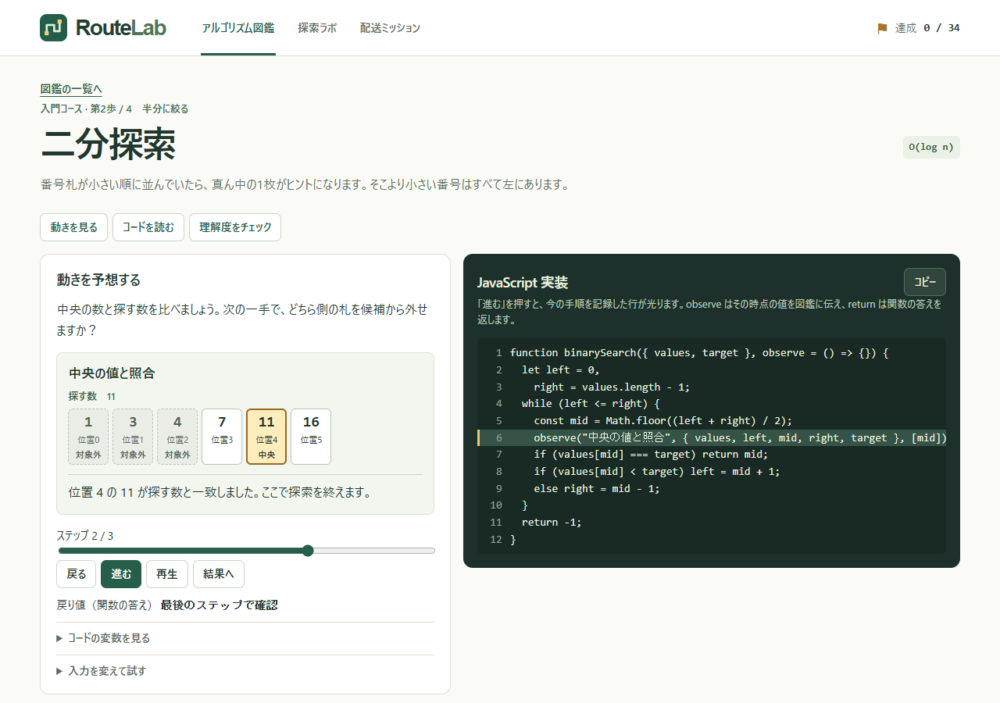
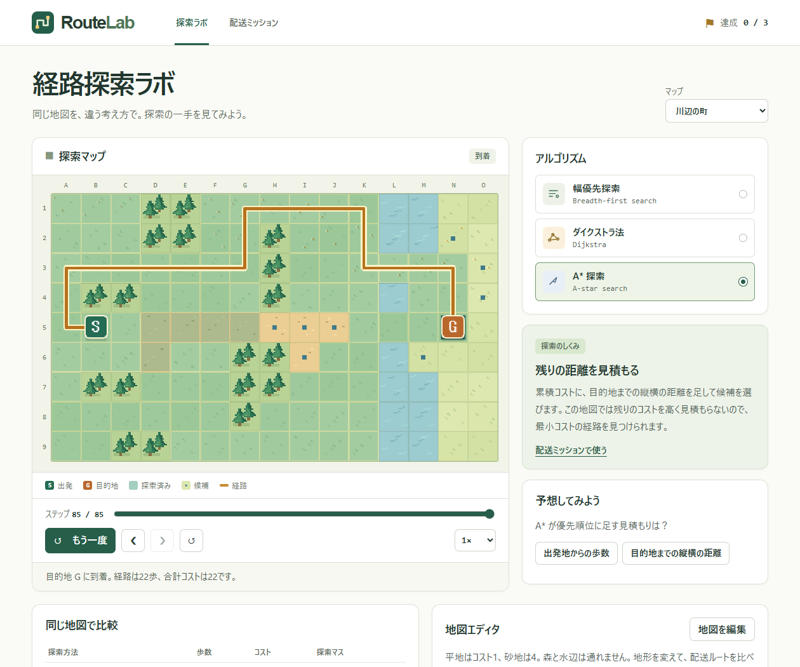

# RouteLab · アルゴリズム図鑑と経路探索ラボ

34のアルゴリズムとデータ構造を、考え方・使いどころ・動くJavaScriptから学べます。入力を変えると、その関数が記録した変数と注目行を1手ずつ観察できます。地図を使った経路探索と配送ミッションにも挑戦できます。



## 起動

Node.js 20 以上がある環境で、次を実行して [図鑑を開きます](http://127.0.0.1:4173/)。

```sh
git clone https://github.com/Gaku-Fujioka/hensatiup.git
cd hensatiup
npm start
```

アプリの起動と探索の単体テストは Node.js の標準機能だけで動きます。

## 教材と学び方

| 分野 | 教材 |
| --- | --- |
| 配列と探索 | 線形探索、二分探索、累積和、二つのポインタ、スライディングウィンドウ |
| ソート | バブル、選択、挿入、マージ、クイック、ヒープ |
| グラフと木 | 幅優先探索、深さ優先探索、トポロジカルソート、ダイクストラ法、A*、二分木の中順走査 |
| データ構造 | スタックと括弧照合、ハッシュ表による頻度集計、Union-Find |
| 貪欲法 | 区間スケジューリング、クラスカル法 |
| 再帰と数理 | 階乗、ユークリッドの互除法、エラトステネスの篩、繰り返し二乗法、バックトラッキング |
| 文字列 | KMP 文字列検索 |
| 動的計画法 | フィボナッチ数列、最少コイン枚数、0/1 ナップサック、最長共通部分列、編集距離、最長増加部分列 |

1. [二分探索](http://127.0.0.1:4173/#learn/binary)で「進む」を押し、配列の中央と残る範囲を追います。「コピー」で、開発者コンソールでも試せる関数と呼び出し例を取得できます。
2. [ソート比較実験](http://127.0.0.1:4173/#compare)で、同じ8個を昇順・逆順にしたときの比較回数を見比べます。方式名を選ぶと、その入力で実行手順を開けます。
3. 教材ごとの理解度チェックで選択理由を確認します。間違えた教材は図鑑の「要復習」で絞り込めます。進捗はブラウザのローカルストレージに保存します。
4. [実装ドリル](http://127.0.0.1:4173/#drill/binary)では、二分探索の境界更新、移動合計、最大公約数、会議室の予約条件、フィボナッチ数列、お釣りの漸化式を自分で書きます。各問4ケースで実測値と期待値を比較でき、別の書き方でも結果が一致すれば成功です。入力できるのは表示された変数と算術・比較式です。

## 地図で試す実験

メニューから [探索ラボ](http://127.0.0.1:4173/#lab) を開きます。



1. 「川辺の町」で幅優先探索を再生します。S から G に直進すると **12歩、コスト33**。砂地は1歩で4のコストがかかります。
2. ダイクストラ法に切り替えて、タイムラインを右端まで動かします。平地を迂回する経路は **22歩、コスト22** です。A*も同じコストで到着します。「同じ地図で比較」で、調べたマスの数を見比べてください。
3. 「地図を編集」で砂地を平地に変え、どの方式が同じ道を選ぶか予想します。地図を選択して矢印キーでマスを移動し、Enterでも配置できます。「元の地形に戻す」でその地図を初期状態に戻せます。
4. 「配送ミッション」では、次に調べるマスの優先順位を式で実装します。値が小さい候補から探索します。式を実行すると3つの地図で採点され、選択中のミッションの地図で自分の経路を再生できます。

## 配送ルール

| 方式 | 優先順位 | この地図で得られる結果 |
| --- | --- | --- |
| 幅優先探索 | 出発地からの歩数 `steps` | 最少歩数 |
| ダイクストラ法 | 出発地からの累積コスト `g` | 最小コスト |
| A* | 累積コストと残り距離の和 `g + h` | 最小コスト。目的地方向の候補を優先しやすい |

上下左右に移動し、入ったマスのコストを加算します。平地は1、砂地は4、森と水辺は通行できません。出発地点のコストは0です。残り距離 `h` は目的地までの縦横の距離の和です。1歩のコストが必ず1以上なので、`h` は実際に必要な残りコスト以下になります。

ミッションで書ける式には、`g`・`h`・`steps`・数値・加算・乗算・括弧が使えます。採点は実際に探索して得た歩数・コスト・探索マス数で決まります。クリアしたミッションは同じブラウザに保存されます。編集した地図はページを再読み込みすると初期状態に戻ります。

## 開発と検証

```sh
npm test
```

探索と式の採点は [src/search.js](src/search.js) と [src/missions.js](src/missions.js) にあります。各探索から返される手順を記録して再生するので、タイムラインを戻しても同じ探索状態に戻れます。

ブラウザ操作のテストには Playwright を使用します。テスト用サーバーはポート4174で自動起動します。

```sh
npm ci
npx playwright install chromium
npm run test:e2e
```

既存の Chrome を使う場合は環境変数 `ROUTELAB_BROWSER` に実行ファイルの絶対パスを指定できます。
